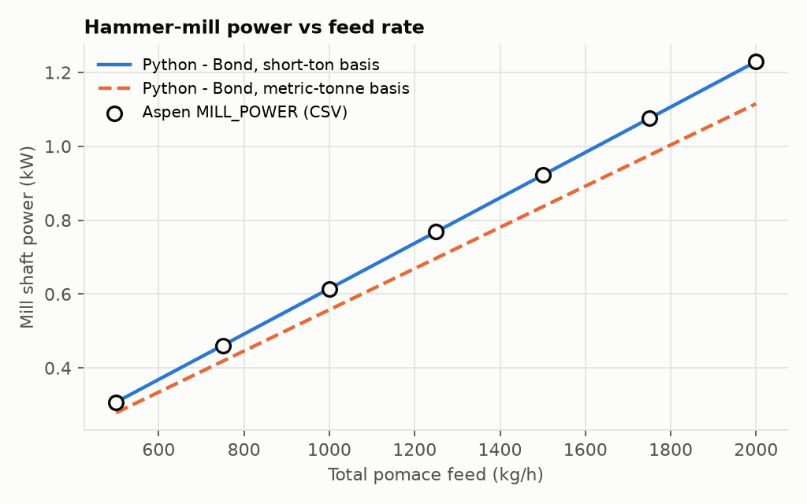
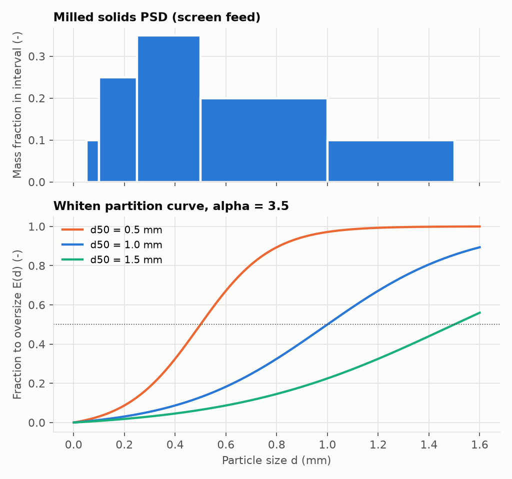
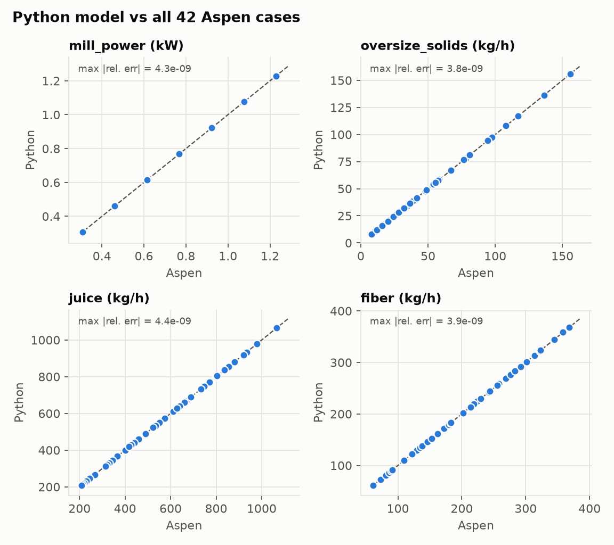

# Step 4 – Equipment-level calculations in Python

**Units chosen:**
- **Hammer mill (MILL)**: crushing energy from Bond's law. This is the main unit for Step 4.
- **Vibrating screen (SCREEN)**: screening performance from the Whiten partition curve.

**Code:**
- `calc/mill.py` and `calc/screen.py` hold the two unit models.
- `calc/psd.py` holds the PSD helpers.
- `calc/process.py` chains the units into the whole flowsheet.

**Verification:** `calc/verify.py` and the pytest suite in `calc/tests/` (43 tests).

```bash
python -m pytest          # 43 tests
python -m calc.verify     # prints the hand calculations + verification tables, saves docs/figures/*.png
```

---

## Unit A – Hammer mill: Bond's third law of comminution

### Governing equation

$$W = 10\,W_i\left(\frac{1}{\sqrt{P_{80}}}-\frac{1}{\sqrt{F_{80}}}\right) \qquad P = \frac{W\,\dot m_\text{solids}}{\eta}$$

| Symbol | Meaning | Unit | Value (base case) |
|---|---|---|---|
| W | specific grinding energy | kWh / ton of solids | 2.7877 |
| W<sub>i</sub> | Bond work index | kWh / ton | 12 (fibrous agricultural biomass) |
| F<sub>80</sub> | 80 % passing size of mill feed | µm | 5666.7 |
| P<sub>80</sub> | 80 % passing size of mill product | µm | 750.0 |
| ṁ<sub>solids</sub> | dry fibre (CIPSD) mass flow | ton/h | 0.22046 short ton/h (200 kg/h) |
| η | mechanical efficiency | – | 1.0 |
| P | mill shaft power | kW | 0.6146 |

**Python inputs:**
- feed rate;
- W<sub>i</sub>;
- solid fraction;
- feed and product PSDs, or F80 and P80 directly;
- ton basis;
- efficiency.

**Outputs:** F80, P80, reduction ratio, W, P, and kWh per tonne of wet feed.

### Assumptions
1. Steady state. W<sub>i</sub> is constant over the size range from 5.7 mm down to 0.75 mm.
2. Bond's law acts on the dry fibre solids only. The juice passes through the mill without absorbing energy.
3. The mill outlet PSD is fixed, as in Aspen ("specify outlet PSD → user-specified"). Mill power therefore depends on the feed rate but not on the screen cut size.
4. Mechanical efficiency is 1.0.
5. The "ton" in W<sub>i</sub> is **Bond's original US short ton (907.18474 kg)**. Aspen Plus uses the same basis; see the finding below.

### Hand calculation (base case: 1000 kg/h wet pomace, 1.0 mm screen)

| Step | Working | Result |
|---|---|---|
| 1. F80 from raw PSD (report Table 1) | Cumulative passing: Q(4 mm) = 0.05+0.07+0.08+0.35 = 0.55, Q(6 mm) = 0.85. Interpolate linearly: F80 = 4 + (0.80−0.55)/(0.85−0.55) × (6−4) | **5.667 mm = 5666.7 µm** |
| 2. P80 from milled PSD | Q(0.5 mm) = 0.10+0.25+0.35 = 0.70, Q(1.0 mm) = 0.90. P80 = 0.5 + (0.80−0.70)/(0.90−0.70) × 0.5 | **0.750 mm = 750 µm** |
| 3. Size term | 1/√750 − 1/√5666.7 = 0.036515 − 0.013284 | 0.023231 µm<sup>−½</sup> |
| 4. Specific energy | W = 10 × 12 × 0.023231 | **2.7877 kWh/short ton** |
| 5. Solids flow | 0.20 × 1000 = 200 kg/h ÷ 907.185 kg/short ton | 0.22046 short ton/h |
| 6. Power | P = 2.7877 × 0.22046 | **0.6146 kW** |

Other results:
- Reduction ratio F80/P80 = 7.56.
- Specific energy = 0.6146 kWh per tonne of wet pomace, or 3.073 kWh per tonne of dry fibre.

### Verification against Aspen

| Check | Python | Aspen | Difference |
|---|---|---|---|
| Base case MILL_POWER | 0.6145768 kW | 0.614576843 kW | −5.6 × 10⁻⁸ % |
| All 7 feed rates (500–2000 kg/h) | Bond's law | CSV `MILL_POWER` | max 4.3 × 10⁻⁹ relative |
| Linear scale-up | P(2000)/P(500) = 4.000 | 1.22915/0.30729 = 4.000 | exact |

**Finding – the ton basis:**
- On a **metric-tonne** basis, Bond's law gives 0.5575 kW. That is 9.3 % below Aspen.
- Only the **short-ton** basis reproduces Aspen.
- So Aspen interprets W<sub>i</sub> = 12 as 12 kWh per *short* ton, which is Bond's original definition. That equals 13.23 kWh per metric tonne.
- The Aspen report labels W<sub>i</sub> as "kWh/tonne". Worth correcting there, or explaining if asked in the presentation.

**Side comparison of the classical laws.** The same F80 → P80 reduction was run through all three laws, with constants matched so they agree for a 1000 → 100 µm reduction:

| Law | Energy |
|---|---|
| Bond | 2.79 kWh/ton |
| Kick | 7.21 kWh/ton |
| Rittinger | 1.06 kWh/ton |

Bond's law is the standard choice for this intermediate size range (mm → sub-mm).



---

## Unit B – Vibrating screen: Whiten partition curve

### Governing equation

$$E(d)=\frac{e^{\alpha x}-1}{e^{\alpha x}+e^{\alpha}-2},\qquad x=\frac{d}{d_{50}}$$

$$\dot m_\text{oversize} = \dot m_\text{solids}\sum_i w_i\,E(\bar d_i),\qquad \dot m_\text{undersize} = \dot m_\text{solids}-\dot m_\text{oversize}$$

| Symbol | Meaning | Unit | Value |
|---|---|---|---|
| E(d) | fraction of particles of size d going to oversize | – | 0 → 1 |
| d̄<sub>i</sub> | representative size of PSD interval i (arithmetic midpoint) | mm | – |
| d<sub>50</sub> | cut size (screen aperture setting) | mm | 0.5–1.5 (base 1.0) |
| α | sharpness of separation | – | 3.5 |
| w<sub>i</sub> | mass fraction of milled solids in interval i | – | report Table 1 |

Useful properties, all checked in the tests:
- E(d<sub>50</sub>) = 0.5 exactly.
- E → 0 as d → 0.
- E increases monotonically with d.
- A larger α gives a sharper screen, closer to an ideal sieve.

### Assumptions
1. Steady state. The partition depends on particle size only, not on shape, moisture or bed depth.
2. There is no bypass (fines entrained with oversize) beyond the Whiten curve itself, no fish-hook, and no breakage on the deck.
3. Each PSD interval is represented by its arithmetic midpoint.
4. Liquid is split separately: 5 wt% of the inlet liquid is entrained into the oversize, as specified in Aspen.
5. α = 3.5 is the Aspen default. It reproduces every Aspen OVERSIZE value, so this is the value the simulation used. It is not listed in report Table 2; consider adding it there.

### Hand calculation (d50 = 1.0 mm, α = 3.5, 200 kg/h solids)

e<sup>α</sup> = e<sup>3.5</sup> = 33.115

| Interval (mm) | d̄ (mm) | x = d̄/d50 | w | E(x) | w·E | Oversize (kg/h) |
|---|---|---|---|---|---|---|
| 0.05–0.10 | 0.075 | 0.075 | 0.10 | 0.00926 | 0.00093 | 0.185 |
| 0.10–0.25 | 0.175 | 0.175 | 0.25 | 0.02564 | 0.00641 | 1.282 |
| 0.25–0.50 | 0.375 | 0.375 | 0.35 | 0.07796 | 0.02729 | 5.457 |
| 0.50–1.00 | 0.750 | 0.750 | 0.20 | 0.28505 | 0.05701 | 11.402 |
| 1.00–1.50 | 1.250 | 1.250 | 0.10 | 0.70951 | 0.07095 | 14.190 |
| **Total** | | | 1.00 | | **0.16258** | **32.52** |

Example row, for the 0.50–1.00 mm interval:
- e<sup>3.5×0.75</sup> = 13.805
- E = 12.805 / (13.805 + 33.115 − 2) = **0.2851**

Results:
- Oversize = 200 × 0.16258 = **32.52 kg/h**. Aspen Table 3 gives 32.52.
- Undersize, which becomes the fibre product = **167.48 kg/h**. Aspen gives 167.48.
- Fibre recovery = **83.74 %**.

### Verification against Aspen

| Check | Result |
|---|---|
| All 42 CSV cases, OVERSIZE | max relative error 3.8 × 10⁻⁹ |
| All 42 CSV cases, FIBER | max relative error 3.9 × 10⁻⁹ |
| All 42 CSV cases, JUICE (with the centrifuge balance) | max relative error 4.4 × 10⁻⁹ |
| Base case stream table (report Table 3: OVERSIZE 72.52, SLURRY 927.48, JUICE 448.96, WET-CAKE 478.52, PRODUCT 167.48) | all within ±0.01 kg/h (rounding) |





---

## Whole-flowsheet balance used by the website (`calc/process.py`)

| Block | Equation (kg/h) |
|---|---|
| Feed | liquid = 0.8 F, solids = 0.2 F |
| MILL | P from Bond's law (Unit A) |
| SCREEN | oversize solids from Whiten (Unit B); oversize liquid = 0.05 × liquid |
| CENTRIF | all slurry solids go to the cake (every milled particle > 0.05 mm); cake liquid = solids × 0.65/0.35 |
| | juice = slurry liquid − cake liquid |
| DRYER | product = cake solids (bone dry); liquid removed = cake liquid |

The overall balance closes exactly. In the base case:
- **In:** POMACE 1000 + HOT-AIR 1500 = 2500 kg/h.
- **Out:** OVERSIZE 72.52 + JUICE 448.96 + PRODUCT 167.48 + EXHAUST 1811.04 = 2500 kg/h.

---

## Notes for the Aspen report / presentation (not changed by this step)

**Ton basis of W<sub>i</sub>.** See the finding under Unit A.

**α = 3.5.** This should appear among the SCREEN inputs in Table 2.

**The dryer heat balance looks infeasible.**
- Evaporating about 280 kg/h of water needs about 2,400 kJ/kg × 280 kg/h ≈ 670 MJ/h ≈ **185 kW**.
- 1500 kg/h of air cooling from 90 °C to 30 °C supplies only about 1500 × 1.006 × 60 ≈ 90 MJ/h ≈ **25 kW**.
- An *adiabatic* dryer with this air flow cannot reach a bone-dry product. Check the EXHAUST temperature in Aspen.
- To fix it, either:
  - specify a heat duty, or
  - size the air flow and temperature for the evaporation load.

**Solubles leave in the exhaust.** In Aspen, glucose and citric acid leave with the EXHAUST. In a real dryer they are non-volatile and stay in the powder, so the product would be about 198 kg/h rather than 167 kg/h.

**Mill power is independent of cut size.** This is because the mill outlet PSD is user-specified. Coupling the screen oversize back to the mill (recycle) would change this; it is a possible future improvement.
